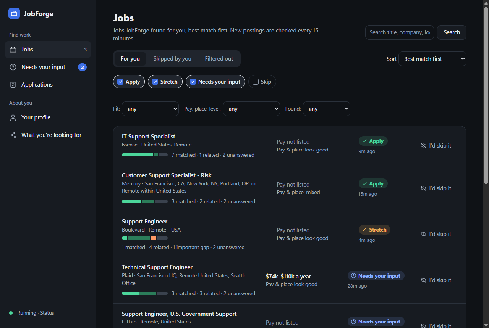
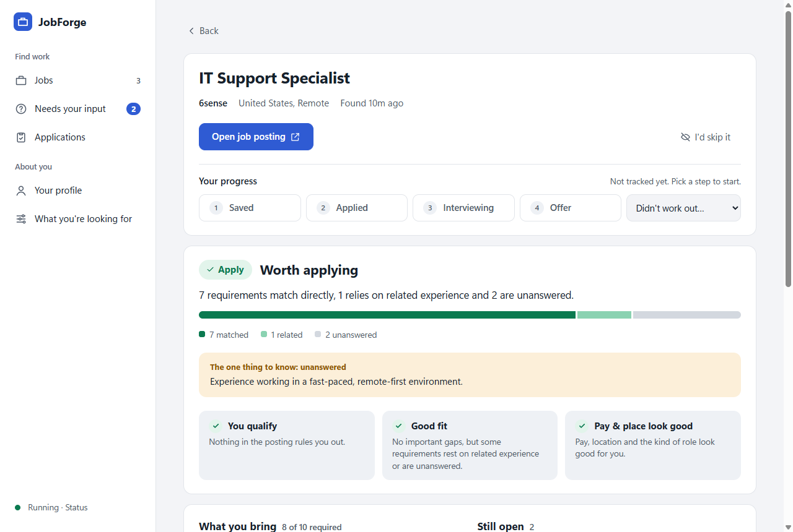
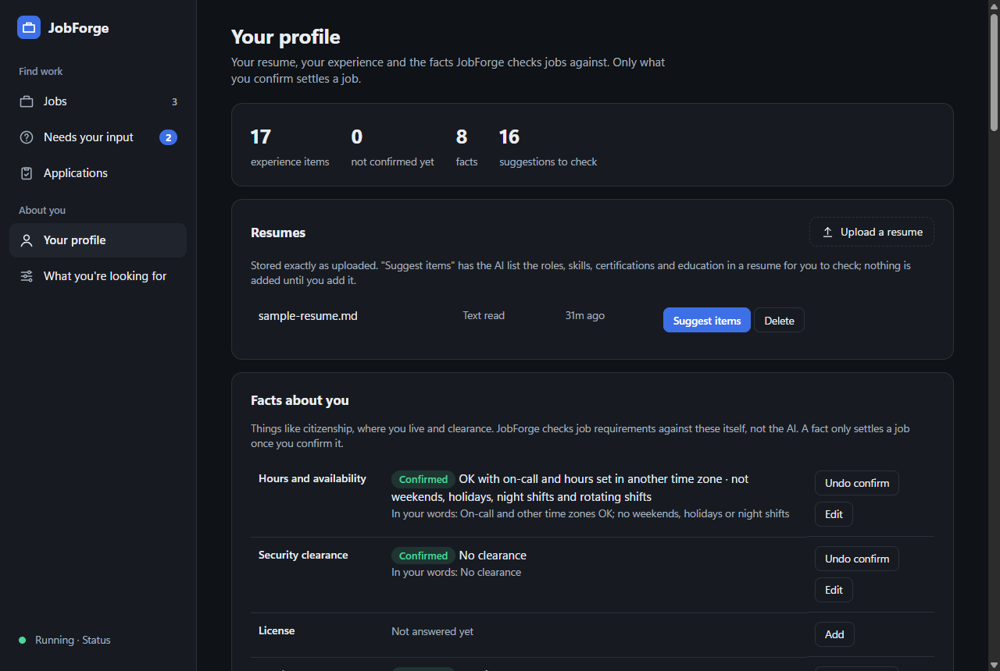
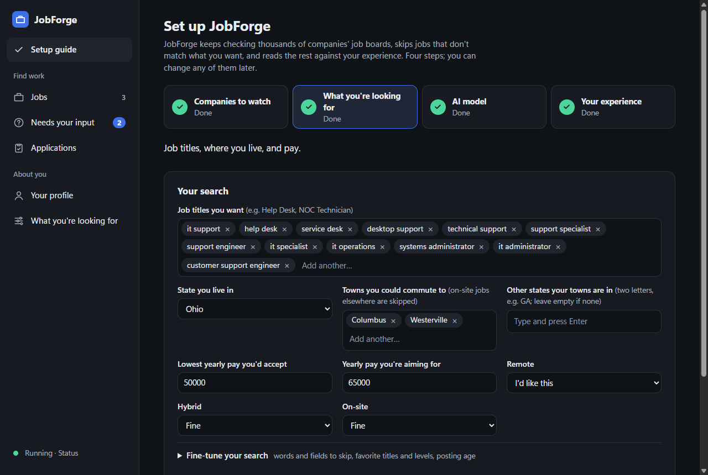

# JobForge

JobForge is a Windows desktop app that does the tedious part of a job search for you. It keeps checking
thousands of companies' job boards, skips the postings that don't fit what you're looking for, and reads the
rest against your own experience, then tells you which jobs are worth applying to and why.

Everything runs on your PC. Postings are read by an AI model running locally in
[LM Studio](https://lmstudio.ai), and your resume and profile never leave your computer. The only network
traffic is JobForge fetching public job boards.

> **Status:** a personal project. There is no published installer yet; see
> [Building from source](#building-from-source).



<table>
  <tr>
    <td></td>
    <td></td>
  </tr>
  <tr>
    <td></td>
    <td>The screenshots show a made-up person (an IT support specialist with a sample resume) and real public job
      postings, judged by JobForge with the local model.</td>
  </tr>
</table>

## What it does

- **Finds jobs.** Watches about 5,800 companies' boards on Greenhouse, Lever and Ashby (a built-in list you can
  turn off) plus any company you add by name or careers link. New postings are checked every 15 minutes.
- **Filters them.** Your search (job titles, where you live and could commute to, pay, remote or on-site) drops
  jobs that don't match before any AI work happens.
- **Judges the rest.** Each remaining posting gets one of four recommendations:
  - **Apply:** you meet the requirements.
  - **Stretch:** worth a try, with one or two gaps.
  - **Needs your input:** JobForge can't decide without an answer from you, and asks a specific question.
  - **Skip:** a requirement rules you out, or too much is missing.

  Every recommendation shows its evidence: which requirements you match, which rely on related experience,
  and the one thing to know before applying.
- **Checks eligibility itself.** Hard requirements like citizenship, clearance, where you live or the hours a
  job needs are checked against facts you confirm, by code, not by the AI.
- **Tracks your applications.** Saved, applied, interviewing, offer, with notes. JobForge never applies or
  contacts an employer for you.

## Using it

1. **Install and set up LM Studio.** Download the model `google/gemma-4-12b-qat`, load it with a context length
   of at least 16,000, and start LM Studio's local server (Developer tab).
2. **Start JobForge.** The setup guide walks you through four steps: companies to watch, what you're looking
   for, checking the AI model, and your experience (upload a resume and JobForge suggests items for you to
   check).
3. **Read your jobs.** "Jobs" lists the ones worth a look, best match first; "Needs your input" lists the
   questions that would settle the rest.

JobForge keeps running in the system tray when you close its window. It refuses to run as administrator.

## How it's built

- **Desktop host:** [Tauri 2](https://tauri.app) (Rust) with a React and TypeScript window (`desktop/`). The
  host supervises the agent, relays its events to the window, and opens links in your browser.
- **Agent:** a Python background process (`agent/`) that owns all the logic and the only connection to the
  database: discovery, filtering, posting analysis, matching and recommendations.
- **Storage:** SQLite, in `%LOCALAPPDATA%\dev.kevin.jobforge`, with daily backups.
- **AI:** LM Studio's local server (`http://127.0.0.1:1234/v1`, an OpenAI-compatible API) with
  `google/gemma-4-12b-qat`.

Design documents:
- [`SPEC.md`](SPEC.md): what is built and why, with a dated change log.
- [`docs/ARCHITECTURE.md`](docs/ARCHITECTURE.md): reasoning, the data model, the evaluation pipeline and its
  rules, and the measurements behind them.
- [`DEFERRED_COMPLEXITY.md`](DEFERRED_COMPLEXITY.md): known gaps and parked work, each with what would trigger it.

## Building from source

Requirements: Windows 10 or 11, [uv](https://docs.astral.sh/uv/) (Python 3.12 or newer), Node.js, and Rust
with the [Tauri prerequisites](https://tauri.app/start/prerequisites/). Use PowerShell, not elevated.

```powershell
# Agent tests
cd agent
uv run pytest -q

# Window: type-check and bundle, then its tests
cd ..\desktop
npm install
npm run build
npx vitest run

# Installer (from the repo root): writes dist-installers\JobForge_<version>_setup.exe
cd ..
powershell -NoProfile -ExecutionPolicy Bypass -File scripts\build.ps1
```

To run the window against a separate data folder while developing, build the host with
`npx tauri build --no-bundle` and start it with `JOBFORGE_DATA_DIR` (the data folder), `JOBFORGE_AGENT_EXE`
(the agent's virtual-environment Python) and `JOBFORGE_AGENT_ARGS=-m jobforge_agent`.

`verify.sh` (Git Bash) prints raw evidence from a running installation (database state, logs, probes) without
judging it.

## Testing and CI

Every pull request to `main` and every push to it runs [CI](.github/workflows/ci.yml), with no secrets, no local
AI model and no private files:

| Job | Runner | What it runs | Locally |
|---|---|---|---|
| Python agent | Windows | `uv sync --locked`, then the agent tests except the two groups below | `cd agent; uv run pytest -m "not integration and not private_config"` |
| Window | Ubuntu | `npm ci`, `npm run build` (type-check and bundle), Vitest | `cd desktop; npm ci; npm run build; npx vitest run` |
| Desktop host | Windows | `cargo check --locked --all-targets`, `cargo test --locked` (after building the window) | `cd desktop\src-tauri; cargo test --locked` |

Two groups of agent tests only run locally; CI leaves them out by name and lists them in each run's summary:

- `integration` starts real agent processes and needs an interactive Windows session (hosted runners are
  elevated and have no desktop).
- `private_config` runs the search-filter regression suite against a private job-scanner config, read from
  `JOBFORGE_SCANNER_CONFIG` (or `..\job-scanner\config.yaml`). Without it the suite is skipped and pytest prints
  why.

`uv run pytest -q` runs everything that can run on your machine.

**Dependencies and security.** Dependabot opens weekly pull requests for the Python, npm, Cargo and GitHub
Actions dependencies, with minor and patch updates grouped; nothing merges without review and a green CI.
CodeQL scans Python, JavaScript/TypeScript and Rust, Dependabot alerts on known vulnerabilities, and secret
scanning with push protection is on. To report a vulnerability, use the repository's **Security** tab
(**Report a vulnerability**) rather than a public issue.
